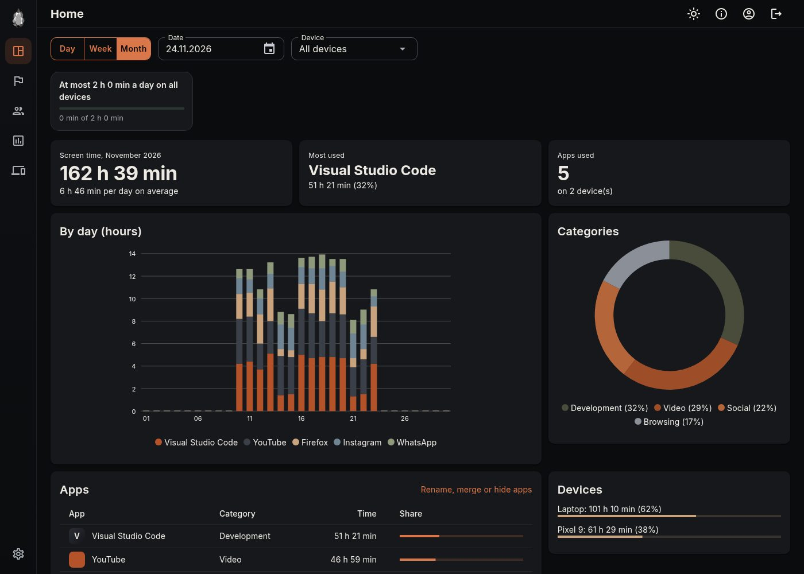
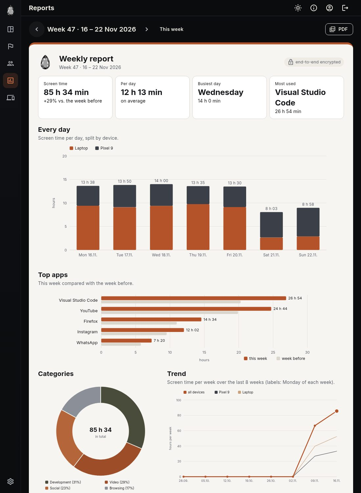
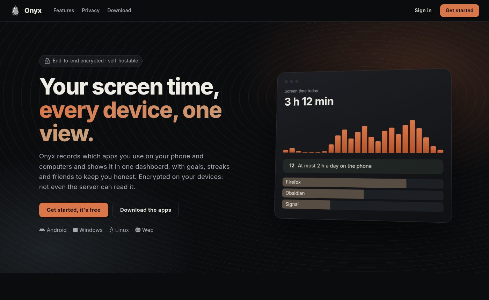
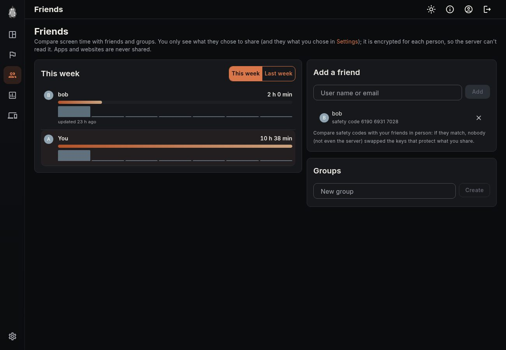
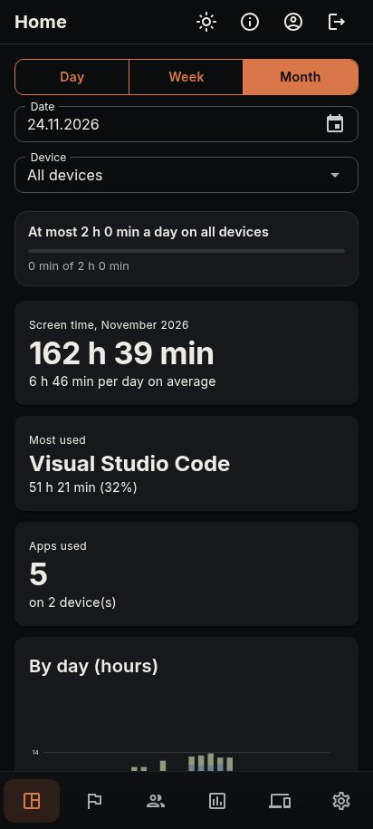

<a id="top"></a>
<h1 align="center">
  
  <br>
  Onyx
</h1>

<h4 align="center">See where your screen time goes, on every device, end-to-end encrypted.</h4>

<p align="center">
  <a href="LICENSE"></a>
  <a href="https://github.com/The-Onyx-Team/Onyx/releases/latest"></a>
  
  
  <a href="https://github.com/The-Onyx-Team/Onyx/actions/workflows/dotnet.yml"></a>
  <a href="https://github.com/The-Onyx-Team/Onyx/commits/master"></a>
</p>

<p align="center">
  <a href="#-private-by-design">Privacy</a> •
  <a href="#-gallery">Gallery</a> •
  <a href="#-features">Features</a> •
  <a href="#-platforms">Platforms</a> •
  <a href="#-getting-started">Getting started</a> •
  <a href="#-versions">Versions</a> •
  <a href="#-documentation">Docs</a> •
  <a href="#-license">License</a>
</p>



<p align="center"><sub>The dashboard for a month on a laptop and a phone: screen time per day split by app,
categories in your own colours, and every app and device. Everything on it was decrypted and drawn in the
browser; the server only ever saw ciphertext.</sub></p>

<table>
<tr>
<td>

**Onyx** records which apps you use on your **Android phone**, your **Windows PC** and your **Linux desktop**, and
for how long, and shows it all in one place: as a dashboard, weekly and custom reports, goals with streaks,
break reminders and a focus mode, and a comparison with friends.

Your devices **encrypt everything before it leaves them**. The server, which you can run yourself with one
`docker compose up`, stores and syncs the data but has no key to read it. Onyx is written in C# with .NET 10:
one Blazor UI runs in the browser (WebAssembly) and inside the native app (.NET MAUI).

</td>
</tr>
</table>

## 🔒 Private by design

| Your devices can read | The server can read |
|---|---|
| Which apps and websites you used, when and for how long | That *some* data exists for an hour, and its size |
| App names, categories and icons | Your user name and email address (to sign in and find friends) |
| Your settings, goals, reminders, focus times and saved reports | Device names and when they last uploaded |
| Your real name, phone number and profile picture | Who is friends with whom |
| What friends share with you (encrypted for you alone) | |

- **AES-256-GCM** for every blob, bound to its user, device, app and hour; app identities are hidden behind keyed
  hashes.
- A **passphrase** (PBKDF2, 600,000 iterations) unlocks your key; a **recovery key** gets you back in. Lose both
  and the data is gone, for everyone.
- **Friends** exchange numbers through ECDH P-256 with a safety code to compare in person.
- **Two-factor authentication** with any authenticator app, external logins (Google, Microsoft, GitHub), a GDPR
  privacy policy and a personal data export (PDF and JSON) built on your device.

Details: [End-to-End Encryption](https://the-onyx-team.github.io/Onyx/encryption.html).

## 📸 Gallery

<table>
  <tr>
    <td width="50%"><br><sub><b>Weekly report.</b> Every day by device, top apps against the week before, categories, an 8-week trend, the time of day and each device. Drawn as SVG on your device and saved as an edge-to-edge A4 PDF.</sub></td>
    <td width="50%"><br><sub><b>Black onyx, pearl and sardonyx.</b> The look follows the gem: dark by default, pearl paper for reports, a red-brown accent.</sub></td>
  </tr>
  <tr>
    <td width="50%"><br><sub><b>Friends and groups.</b> Compare the week with friends; each of them gets your numbers encrypted for them alone, at the level you choose (total, categories, goals). Apps and websites are never shared.</sub></td>
    <td width="50%" align="center"><br><sub><b>On the phone.</b> The same UI inside the Android app, with an icon bar at the bottom.</sub></td>
  </tr>
</table>

## ✨ Features

<table>
<tr>
<td width="50%" valign="top">

**Seeing**
- Dashboard by day, week (ISO week numbers) or month, per device or all of them
- Apps grouped by name across platforms: Firefox on the phone and the PC is one app
- Your own app names, categories with colours, icons (upload or a website's icon), hidden apps
- Websites per browser tab (domain only), with the Onyx browser extension on Windows and Linux
- Weekly report and **custom reports** (any period, devices, apps, sections), both as PDF

</td>
<td width="50%" valign="top">

**Changing**
- **Goals:** limits or targets per day or week, for everything, a device, a category or an app, with streaks
- **Reminders:** a break after an hour without one, or a daily limit, per app, category and device
- **Focus mode:** now or on a schedule; every device nudges you when a distracting app comes up
- **Friends and groups** to compare with, at a sharing level you choose
- A personal data export, and deleting your account deletes everything

</td>
</tr>
</table>

## 📱 Platforms

| Platform | How it records | Notes |
|---|---|---|
| 🤖 **Android** 7+ | Android's usage statistics, read every 30 minutes | Nothing runs in between; reminders every 15 minutes |
| 🪟 **Windows** 10/11 | The foreground window every 2 seconds, idle time excluded | Runs in the notification area, starts at sign-in |
| 🐧 **Linux** | `onyx-agent`, a systemd user service | Hyprland, Sway, GNOME (with a small Shell extension), KDE Plasma (KWin script), any X11 desktop |
| 🌐 **Browser** | – | The full dashboard, decrypted in the browser (WebAssembly); needs HTTPS |
| 🍎 **iOS / macOS** | – | Not yet: iOS doesn't let apps read other apps' usage |

## 🚀 Getting started

**Use it:** download the Android app, the Windows app or the Linux agent from the
[latest release](https://github.com/The-Onyx-Team/Onyx/releases/latest), and sign in to a server.

**Run your own server** (Docker, SQLite or SQL Server, keys and data in volumes):

```sh
git clone https://github.com/The-Onyx-Team/Onyx.git && cd Onyx
cp .env.example .env        # operator details for the privacy policy, mail, external logins
docker compose up -d --build
```

> [!NOTE]
> The web dashboard needs HTTPS (or `localhost`), because browsers only offer WebCrypto on secure connections.
> Put the server behind a reverse proxy, or reach it through Tailscale; see
> [Self-Hosting](https://the-onyx-team.github.io/Onyx/self-hosting.html).

**Develop:** .NET 10 SDK (and `dotnet workload install maui-android` for the app):

```sh
dotnet run --project src/Onyx.App/Onyx.App.Web     # API + dashboard at http://localhost:5262, SQLite
dotnet test                                         # unit tests
dotnet run --project src/Hosting/AppHost            # with SQL Server and MailDev containers (.NET Aspire)
packaging/android/build-apk.sh --server https://onyx.example.com --install
```

In Development the server seeds `admin@admin.com` / `Admin123456` with two weeks of sample usage.

## 🏷️ Versions

Every push to `master` that passes the tests is released as the next minor version (v0.3 → v0.4), with the
Android, Windows and Linux builds and the server image `ghcr.io/the-onyx-team/onyx:<version>`. `[major]` in a commit
message starts the next major version. Every app shows its version and the server's on its About page.
See [Releasing](https://the-onyx-team.github.io/Onyx/releasing.html).

## 📖 Documentation

The documentation is at **[the-onyx-team.github.io/Onyx](https://the-onyx-team.github.io/Onyx/)** (sources in
`docs/Writerside/`):

| For | Read |
|---|---|
| Using Onyx | [Android App](https://the-onyx-team.github.io/Onyx/android-app.html) · [Linux Agent](https://the-onyx-team.github.io/Onyx/linux-agent.html) · [Websites](https://the-onyx-team.github.io/Onyx/websites.html) · [Focus, Reminders and Reports](https://the-onyx-team.github.io/Onyx/focus-and-reports.html) |
| Running a server | [Self-Hosting](https://the-onyx-team.github.io/Onyx/self-hosting.html) · [End-to-End Encryption](https://the-onyx-team.github.io/Onyx/encryption.html) |
| Developing | [Developer Documentation](https://the-onyx-team.github.io/Onyx/developer-documentation.html) · [Database](https://the-onyx-team.github.io/Onyx/database.html) · [Releasing](https://the-onyx-team.github.io/Onyx/releasing.html) |

## 🤝 Contributing

Issues and pull requests are welcome. Pull requests to `master` and `dev` run the build and the tests, which must
pass. Schema changes need a migration for both SQLite and SQL Server
([Database](https://the-onyx-team.github.io/Onyx/database.html)), and anything that touches user data has to stay
encrypted on the client: the server only checks ownership, sizes and formats.

## ⚖️ License

Onyx is licensed under the **GNU Affero General Public License v3.0**: if you run a modified server for others,
you share its source. See [LICENSE](LICENSE).

<p align="right"><a href="#top">back to top ↑</a></p>
